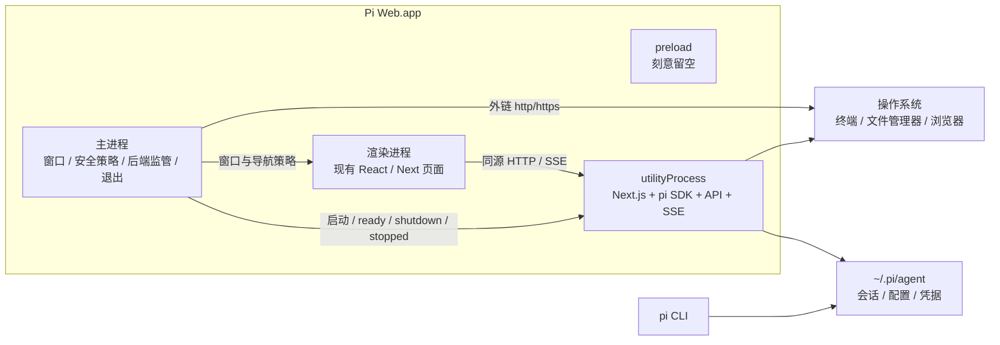

# Pi Web Electron 桌面端设计记录与实施现状

> 状态：**已实现**（macOS arm64，未签名）。本文保留最初的设计取舍，并逐条标注落地结果；已交付的能力用现在时描述，未做的部分明确写成未实现。
> 代码位置：`desktop/`、`electron-builder.yml`、`next.config.ts` 的桌面构建开关、`lib/desktop-env.ts`、`lib/desktop-auth.ts`、`proxy.ts` 的桌面分支。
> 细节以 [docs/agents/desktop.md](./agents/desktop.md) 为准；本文不重复实现细节，只记录架构结论、边界和现状。
> 文件名沿用规划阶段的 `desktop-electron-plan.md`，内容已改写为设计记录 + 实施现状，不再把已交付能力写成待做项。

## 1. 结论

桌面端采用 **“Electron 薄壳 + 独立后端进程 + 现有 React 页面”**，已按此实现：

- Electron 主进程负责窗口、导航拦截、后端生命周期、原生菜单和退出协调；它不导入 pi SDK，不运行 agent。
- 后端进程用 `electron.utilityProcess.fork()` 运行现有 Next.js、pi SDK、会话、SSE、终端、MCP 和文件 API，使用 Electron 自带的 Node 运行时。
- 渲染进程加载 `http://127.0.0.1:<随机端口>` 上的现有页面，通过同源 HTTP/SSE 与后端通信，没有为产品数据新增 IPC。
- 桌面端与浏览器版共享 `app/`、`components/`、`hooks/`、`lib/`，不存在第二套桌面 UI。
- 生产环境使用现有 `output: "standalone"` 产物，用户无需另装 Node.js。

被否掉的三条路线理由不变：静态导出会丢失服务端能力；把 Next 塞进主进程会阻塞窗口事件循环；把 HTTP/SSE 改写成 IPC 会产生长期双协议维护成本。

## 2. 现有架构的复用情况

| 能力 | 实现位置 | 桌面端处理 | 现状 |
| --- | --- | --- | --- |
| Next.js 16 + React 19 | `app/`、`components/` | 原样复用 | 已交付 |
| Node 服务端与 standalone 输出 | `next.config.ts` | 后端进程内的唯一服务 | 已交付 |
| pi 会话与 SDK | `lib/rpc-manager.ts` | 保留在后端进程 | 已交付 |
| SSE 会话事件 | `app/api/agent/[id]/events/route.ts` | 保留 HTTP/SSE | 已交付 |
| 会话文件与配置 | `~/.pi/agent`、`lib/session-reader.ts` | 与 pi CLI 共享 | 已交付 |
| 终端 | `lib/terminal-manager.ts`、`node-pty` | 后端运行，包后 smoke 校验原生产物 | 已交付 |
| MCP、扩展、技能、插件 | `lib/mcp-*.ts`、`lib/pi-sdk-internals.ts` | 保持现有加载与信任模型 | 已交付；插件/技能安装依赖用户 `PATH` 里的 npm |
| 文件访问白名单 | `lib/file-access.ts` | 权限未扩大 | 已交付 |
| Host/Origin 防护 | `lib/request-security.ts`、`proxy.ts` | 全部保留，另加桌面会话分支 | 已交付 |
| 本机文件管理器 | `app/api/open-in-explorer/route.ts` | 后端与本机同环境 | 已交付 |
| 下游右键菜单钩子 | `pi-web:session-row-contextmenu` | 预留给原生菜单 | 仅保留钩子，未接原生菜单 |

## 3. 进程架构



### 3.1 主进程

只承担桌面外壳职责，代码在 `desktop/main/`：

- 单实例锁；第二次启动退出，由已运行的实例聚焦窗口。
- 启动、监管、停止后端；区分 `ready`、`fatal`、`stopped`，启动失败弹原生错误框并给出日志位置。
- 限制导航与新窗口，外部链接交给系统浏览器。
- 应用菜单：`Retry Backend`、`Open Logs`；未打包时额外有 `Reload Page`。
- 持有桌面会话密钥，只在 `ready` 之后用一条 `session` 消息经 utilityProcess IPC 交给后端，不进入渲染进程 JavaScript、URL、命令行参数、环境变量或日志。
- 恢复 GUI 启动环境（登录 shell 的 `PATH` 等），只把结果交给后端。

### 3.2 后端进程

- `utilityProcess.fork()` 运行后端入口（打包后是 `Resources/backend/desktop/server/index.js`），使用 Electron 自带的 Node。
- `listen(0, "127.0.0.1")` 由系统分配端口，通过消息回报真实 origin，没有“先探测再关闭”的端口竞争。
- 保留现有 API、SSE、会话注册表、终端注册表、MCP Host 和 instrumentation。
- 启动失败或异常退出由主进程呈现为可诊断错误，不自动拉起。

选择独立进程而非主进程内嵌，是为了隔离 CPU/内存压力、原生模块崩溃和扩展异常；实测关窗后后端与 PTY 不会残留（见第 9 节的 smoke 检查）。

### 3.3 渲染进程与 preload

渲染进程仍是普通 Web 页面，窗口选项固定在 `secureWindowOptions()` 一处：

```text
nodeIntegration: false
contextIsolation: true
sandbox: true
webSecurity: true
allowRunningInsecureContent: false
```

`desktop/preload/index.ts` **刻意留空**：没有 `contextBridge`、没有 `ipcRenderer`、没有全局对象，主进程也没有任何 `ipcMain` 处理器。计划里的“版本、检查更新、重启后端、原生通知”等 preload 能力最终没有做：重启通过菜单（主进程内）完成，版本与更新没有桌面通道。若将来要加，需要把它当成产品决策而不是外壳细节。

## 4. 启动、窗口与退出

### 4.1 开发模式

最终实现与最初计划有一处差异：**没有新增 `npm run dev:desktop`**。未打包启动（`app.isPackaged === false`）即为开发模式：

1. 探测 `http://127.0.0.1:30141`，分为 `attached`（已有健康 Pi Web）、`absent`（端口空闲）、`occupied`（被其他程序占用）。
2. `attached` 直接复用；`absent` 才以 `shell: false`、应用目录为 cwd 启动 `npm run dev`；`occupied` 直接报错。
3. 页面就绪后加载开发地址，保留 HMR；开发模式不注入生产 cookie，浏览器版的认证规则照常生效。
4. 退出时只停止自己启动的开发服务，复用的那个不动。

不启动第二个 `next dev`（避免 `.next/dev/lock` 竞争），也不退回 `next dev --webpack`。这条复用路径只做了单元测试覆盖（`classifyDevelopmentProbe()` 等），没有在真实 dev server 上端到端跑过。

### 4.2 生产启动

1. 主进程获得单实例锁。
2. 恢复 GUI 环境，生成 32 字节（64 位十六进制）桌面会话密钥。
3. 启动后端进程，用环境传递 `PI_WEB_DESKTOP=1`、`PI_WEB_DESKTOP_SESSION`、`PI_WEB_DESKTOP_LOG_DIR`。
4. 后端监听 `127.0.0.1:0`，回报 `ready` 与真实端口。
5. 主进程**先设置并等待 cookie，再探测完整首页，最后才 `loadURL`**；顺序颠倒会闪出未认证的页面。
6. 启动超时或失败时显示日志位置与重试动作，不打开系统浏览器。

页面加载使用 `http://127.0.0.1:<port>` 而非 `file://`，同源 API、Cookie、SSE 与下载行为因此保持不变。

### 4.3 新窗口与外部链接

- 同源导航保留；`window.open` 一律拒绝并改由主进程创建同款安全窗口。
- 无凭据的 `http(s)` 外链交给 `shell.openExternal`，只打开一次；指向本机其他端口的地址拒绝。
- 其他协议丢弃；webview 一律拒绝；权限默认拒绝，只对后端 origin 放行固定的少量权限。
- `?session=<id>`、`?cwd=<dir>` 链接格式不变。

### 4.4 退出

不做托盘常驻：最后一个窗口关闭即退出，运行中的 agent 不会静默留在后台。退出协调器是单一 promise，被 `before-quit`、窗口关闭、SIGINT/SIGTERM 和失败路径共用：

1. 发送后端 `shutdown`（预算默认 60 s，允许 30–120 s）。
2. 后端停止接收新请求，按顺序释放 AgentSession、终端、升级连接、HTTP 服务，回 `stopped` 后 `exit(0)`。
3. 主进程等待 `stopped` 与进程退出，两步各有独立期限，超时才强制结束。
4. 清理顺序为**后端 → cookie → 窗口**，不留“窗口还在、cookie 还有效、后端已死”的状态。
5. 第二次信号或后端超出停止宽限期时走硬杀，避免孤儿进程。

关窗被 `handleLastWindowClose` 拦到退出协调器批准为止；交互式退出先读 `/api/agent/running`（3.5 s 上限），若有运行中的 run、子 Agent 或非 idle 状态，弹一个原生纯文本确认框（默认按钮是“取消”），避免误按 Cmd-W 打断正在跑的回合。`before-quit` 与信号路径不弹框，只记 `quit.noninteractive` 后直接退出，smoke 的 SIGTERM 检查依赖这一点。

整个过程只走进程 IPC，不新增未经认证的 HTTP 管理接口。渲染进程崩溃只重建页面；后端崩溃由菜单的 `Retry Backend` 重启。

## 5. 认证与安全边界

### 5.1 桌面会话认证（已交付）

loopback 不等于可信：同机其他进程仍可能扫描端口，恶意网页也可能尝试跨站请求。因此没有关闭认证，而是增加了每次启动随机生成的桌面会话：

1. 主进程生成 32 字节随机值（64 位十六进制）。
2. 主进程生成 32 字节随机值（64 位十六进制），并在 `ready` 之后用一条 `session` 消息经 utilityProcess IPC 通道交给后端（`child.postMessage(createSessionHandoff(secret))`，后端从 `process.parentPort` 读取）。它不经过命令行、环境变量、文件或 URL，也不进日志与 preload 全局对象。`PI_WEB_DESKTOP_SESSION` 只是测试和直接启动时的备用通道，**不是**打包启动的实际传递路径（早期草案里的 `PI_WEB_DESKTOP_TOKEN` 已废弃）。
3. `loadURL` 前设置 host-only、`HttpOnly`、`Secure`、`SameSite=Strict`、会话级（无过期时间）的 `__pi-web-session` cookie，并在加载前等待写入完成。
4. 后端入口校验 64 位小写十六进制后把它写进认证上下文，并注册到 logger redactor（控制台与日志中的副本会被打码）；若值来自环境变量则立即删除，再加载 Next 与 pi SDK。
5. `proxy.ts` 的桌面分支：带有效桌面会话的请求放行，写操作额外要求 `Origin` 精确等于桌面 origin；没有 cookie 时回到浏览器版的 `PI_WEB_PASSWORD` 规则，未设置密码即关闭（fail-closed）。

Cookie 随请求发送但页面脚本读不到它；每次启动更换，不写持久存储。

### 5.2 保留的防护

- 继续使用 `isApiRequestAllowed()` 的 Host、Origin 与 Fetch Metadata 检查；后端额外要求 `Host` 精确等于 `127.0.0.1:<port>`。
- 后端只绑定 `127.0.0.1`，桌面模式不监听 `0.0.0.0`。
- 登录限流、安全响应头、HTML iframe sandbox 和文件下载规则不变。
- `lib/file-access.ts` 的 allowed roots 未扩大；本机文件管理器沿用现有实现。
- OAuth/MCP 登录继续使用系统浏览器和现有手工回调流程，没有注册自定义协议。

### 5.3 子进程环境脱敏

`lib/desktop-env.ts` 定义桌面宿主变量名单（`PI_WEB_DESKTOP`、`PI_WEB_DESKTOP_SESSION`、`PI_WEB_DESKTOP_LOG_DIR`、`PI_WEB_PASSWORD`），并用于：

- 终端 shell 的环境（`lib/terminal-manager.ts`）；
- agent/bash 命令的环境；
- MCP stdio 服务器共用的清理（`lib/mcp-transport.ts`）；
- 日志、fatal 消息与堆栈的脱敏（`desktop/server/redaction.ts`）。

只按名单过滤：`*_TOKEN` / `*_KEY` 之类的通配会误伤 pi SDK 需要读取的 provider 凭据。

**边界说明**：第三方 pi 扩展仍在后端拥有 pi 扩展的正常权限。Electron renderer sandbox 不能被描述成对 pi 扩展的 OS 沙箱。

## 6. 数据、环境与桌面行为

### 6.1 数据复用（已交付）

- 默认继续使用 pi 的 `getAgentDir()` 与 `~/.pi/agent`，并尊重 `PI_CODING_AGENT_DIR`。
- 桌面端与 CLI 可查看同一会话和模型配置；没有把会话迁移到 Electron `userData`、IndexedDB 或另一套数据库。
- 并发写入继续依赖现有原子写入与锁。
- Electron `userData` 里没有业务数据，只有 Chromium 自身的缓存；桌面日志在 `~/Library/Logs/Pi Web/main.log`（启动时轮转一次，保留一份旧文件），可从应用菜单打开。窗口位置当前不持久化，每次以默认尺寸打开。

### 6.2 GUI 启动环境（已交付）

macOS Finder/Dock 启动不继承用户 shell 的完整 `PATH`。启动后端前：

- 通过用户登录 shell（`zsh -lic`）一次性恢复环境，带超时与输出上限；
- 探测环境已剔除桌面变量，不执行项目命令，输出也不会显示成 agent 内容；
- 结果只传给后端，不污染主进程全局环境；
- 探测失败时退回系统环境与内置 `PATH` 兜底，并把原因写进日志。

### 6.3 桌面交互范围（现状）

已完成：应用窗口与菜单、程序图标、外部链接与同源新窗口、现有“在 Finder 中打开”、后端故障提示与 `Retry Backend` / `Open Logs`、单实例聚焦。

未做：托盘/菜单栏常驻、原生更新提示、系统通知、原生会话右键菜单、自定义协议深链接、多窗格 IDE、文件编辑、另一套设置系统。会话右键仍使用 Web 菜单；将来要接原生菜单，直接消费已有的 `pi-web:session-row-contextmenu`，不要复制 Sidebar 逻辑。

## 7. 构建与打包

### 7.1 实际目录

```text
desktop/
  main/                 # 主进程：窗口、安全、后端监管、环境、退出
  preload/              # 空 preload（保持窗口 preload 指向真实模块）
  server/               # 后端入口、Next 监听、退出状态机、脱敏
  shared/               # 主进程与后端共享的协议/常量
  packaging/            # build-desktop.mjs、smoke-desktop.mjs、应用 package.json、tsconfig
electron-builder.yml    # 打包配置
dist/desktop/           # 构建中间产物（不入库）
release/                # .app 与 DMG（不入库）
```

计划里的 `desktop/backend-entry.cjs`、`desktop/resources/`、`scripts/*.mjs` 均未采用：后端入口是 `desktop/server/index.ts`（编译为 CJS），脚本放在 `desktop/packaging/`。主进程与 preload 用 `tsc` 单独编译为 CommonJS，不与 Next 客户端混 bundle。

### 7.2 构建顺序（`npm run build:desktop`）

1. Next standalone 构建到隔离的 `distDir`：`PI_WEB_DESKTOP_BUILD=1`、`PI_WEB_DESKTOP_DIST_DIR=dist/desktop/next`。开发服务器的 `.next` 完全不被触碰。
2. 把 `.next/static` 与 `public` 补进 standalone 树，并按锁文件补齐生产 `node_modules`。
3. `tsc` 编译外壳：先 `--noEmit` 做类型门禁，再 emit。
4. 组装 `dist/desktop/app`（壳 + 注入版本号的 package.json）与 `dist/desktop/backend`（后端入口、共享模块、`next-standalone`、后端 `lib/` 模块与 shim）。
5. 冻结的目录布局检查（11 条路径）。
6. `electron-builder --mac --arm64`，并设置 `CSC_IDENTITY_AUTO_DISCOVERY=false`。

可用开关：`--skip-next`（复用已构建的 distDir）、`--dir`（仅未压缩 `.app`）、`--skip-pack`（不打包）。

`next.config.ts` 只在上述两个环境变量存在时才切到 `output: "standalone"` 与替代 `distDir`，浏览器版构建与之前一致。

### 7.3 后端位置、模块实例与原生模块

- 后端整体作为 `extraResources` 落在 `Resources/backend`，**不进 asar**：它需要真实路径和自己的 `node_modules`；smoke 检查会断言 `app.asar.unpacked/backend` 不存在。
- 但 `app.asar` **并不是“只装外壳”**：外壳（`main`、`preload`、`shared`）只有约 160 KB，打包器仍把根项目的生产 `node_modules` 一并塞进 asar（本机实测 298 MB，原生包解到 `app.asar.unpacked/node_modules` 下的 `@earendil-works`、`@img`、`@next`、`node-pty`、`quickjs-wasi`）。这份依赖树与后端重复，运行时外壳并不需要它，却把每个产物都撑大。这是一个已知的体积限制和打包陷阱：`directories.app: dist/desktop/app` + `files: ["**/*"]` 并不会收窄依赖集合，真要收窄得改成显式 `files` / `asarUnpack` 白名单，并重新用 smoke 验证一遍。
- standalone 输出会把 distDir 嵌套一层，组装时把服务端文件移到 `.next` 并改写 `required-server-files.json` 的 `distDir`；后端 `lib/` 模块与 shim 一起复制，保证 `desktop/server` 和 Next 路由拿到**同一个模块实例**（两份副本等于两套会话注册表和两套终端注册表）。
- `node-pty` 用官方 darwin-arm64 预编译产物，必须连同可执行的 `spawn-helper` 一起进入独立 `node_modules`；Next tracing 可能漏收，所以由构建检查与 smoke 实测，而不是相信 trace。
- `@earendil-works/*` 继续保持精确版本锁定，避免打包时解析出第二份 SDK。

### 7.4 macOS 分发边界（现状）

首版**未签名、未公证**（`identity: null`、`hardenedRuntime: false`），只产出 DMG；`publish: null`，不接自动更新。最低系统为 macOS 12，架构仅 arm64。首次启动需要右键“打开”或执行 `xattr -dr com.apple.quarantine`。不上 Mac App Store、不启用 App Sandbox：Pi Web 需要访问任意项目目录、pi 配置、shell 与 agent 子进程，MAS 沙箱需要另一套目录授权设计，应单独立项。

产物规模（本机实测）：`Resources/backend` 643 MB，`app.asar` 298 MB，未压缩 `.app` 约 1.3 GB，DMG 约 366 MB。其中 asar 的 298 MB 是重复体积（根项目生产依赖被再打一份），不是外壳本身；要缩小只能改成白名单式收依赖，会重新引入运行期缺包风险，暂不做。

## 8. 更新与发布（未实现）

计划中的 electron-updater、Draft Release、签名版本升级验收、三平台 matrix 都**没有实施**：

- 应用内没有更新检查通道，也没有“检查更新”入口；
- 升级方式是下载新的 DMG 覆盖安装；
- 现有 npm / Docker / GitHub Release 发布流程未改动，桌面产物也不在自动发布流水线里。

若将来接入更新，仍需遵守原设计约束：根 `package.json` 版本作为唯一版本来源；桌面端关闭 npm 更新提示；tag 构建先出 Draft，等签名、包后 smoke 和产物复核完成再公开；PR CI 用 `--dir` 做未签名打包与启动测试，正式 tag 才签名公证。

## 9. 测试与验收

### 9.1 自动化现状

- `desktop/` 单元测试用 `node:test` + 注入假实现，不需要 Electron 二进制、pi SDK 或真实端口：协议校验、阶段流转与超时、cookie 先于加载的顺序、导航与外链判定、开发探测分类、后端配置与 handoff 拒绝、Host/Origin 防护、有序退出与超时、脱敏。
- `npm test` 的 glob 只覆盖 `app/`、`components/`、`hooks/`、`lib/`、`public/`，**不含 `desktop/`**。桌面测试需显式运行：

  ```bash
  node --import ./desktop/main/__tests__/ts-resolve.mjs --test --test-timeout=20000 \
    desktop/shared/__tests__/*.test.mjs desktop/main/__tests__/*.test.mjs \
    desktop/server/__tests__/*.test.mjs
  ```

- `npm run smoke:desktop` 是包后验收：布局路径、后端在 asar 之外、node-pty 预编译与可执行 `spawn-helper`、`~/.pi/agent` 存在、应用可启动、`main.log` 里有带 origin 的 `backend.ready`、loopback 页面可访问、未认证 API 被拒、SIGTERM 时干净退出、日志出现 `[desktop] shutting down`、收到 `backend.stopped_signal`、没有失败的退出步骤、没有孤儿后端进程。
- 仓库既有检查（`npm test`、`tsc --noEmit`、`npm run lint`）在桌面改动后仍全部通过；桌面测试是增量，不替代它们。

### 9.2 验收矩阵与覆盖情况

| 类别 | 验收点 | 现状 |
| --- | --- | --- |
| 启动 | 无系统 Node 可启动；不打开外部浏览器；随机端口无冲突 | 包后 smoke 覆盖 |
| 会话 | 浏览、恢复、新建、发送、停止、SSE 断线重连 | 复用 Web 逻辑，未做桌面专属 E2E |
| CLI 共存 | 与 pi CLI 共享配置和会话 | 共用 `~/.pi/agent`，未做并发压测 |
| 终端 | 创建、输入、resize、重连、退出 | 原生产物已校验，交互未自动测试 |
| 文件 | allowed roots 不扩大；`open-in-explorer` 可用 | 逻辑复用，未做桌面专属验证 |
| MCP/OAuth | stdio 环境脱敏；系统浏览器登录 | 脱敏有测试；登录流程未在包后实测 |
| 扩展 | 用户扩展、内置扩展、动态加载、项目信任不变 | 后端进程内复用，未做包后专项验收 |
| 插件/技能 | 无系统 Node 时安装路径可用或有降级 | 应用不带 npm/npx，依赖用户 `PATH` |
| 生命周期 | 关窗、崩溃、强退后无后端/终端孤儿 | smoke 覆盖正常退出；崩溃路径靠单元测试 |
| 更新 | 签名版本可升级、失败可回滚 | 未实现 |

计划中的 Playwright Electron E2E 未实施：已验证的是“打包后启动 + 安全防护 + 有序退出”，不是“逐功能点按 UI 操作”。

## 10. 阶段完成情况

| 阶段 | 内容 | 状态 |
| --- | --- | --- |
| A：开发壳与进程骨架 | main/preload、安全窗口工厂、导航/外链策略 | 已完成 |
| B：生产后端与安全认证 | standalone、后端入口、随机端口、ready/shutdown IPC、桌面会话、环境脱敏、GUI 环境恢复 | 已完成 |
| C：原生依赖与完整功能 | node-pty、后端资源、日志、MCP/扩展/文件能力 | 已完成（部分能力靠复用而非专项验收） |
| D：签名、安装器与自动更新 | 签名、公证、Draft Release、updater、多平台 matrix | **未实施** |

## 11. 已知限制

| 限制 | 影响 | 处理 |
| --- | --- | --- |
| 仅 macOS arm64 | 其他平台无产物 | 未来平台需各自构建并验证 `.node` |
| 未签名、未公证 | 首次启动被 Gatekeeper 拦截 | 右键“打开”或 `xattr -dr com.apple.quarantine` |
| 无自动更新 | 需手动下载覆盖 | 保持 DMG 覆盖安装 |
| 无托盘/菜单栏常驻 | 关窗即退出 | 有意为之：不留后台 agent |
| 不带 npm/npx | 插件、技能安装依赖用户 `PATH` | 明确写进用户文档 |
| `app.asar` 含约 298 MB 重复生产依赖 | 安装体积翻倍，外壳本身仅约 160 KB | 收窄需 `files` 白名单并重跑 smoke，风险高于收益，暂不改 |
| 依赖 Next 私有 `router-server` 入口 | Next 主版本升级可能失效 | 包后 smoke 是发布门禁 |
| 依赖 `require(ESM)` 与 CJS 条件补丁 | 上游若出现顶层 `await` 会失败 | 升级 pi/Next 时重跑 `build:desktop` 与 smoke |
| 认证 200 与页面 DOM 未自动验证 | 只能间接证明（403/401 + `backend.ready`） | 保持手工验收 |
| 开发复用 30141 未端到端验证 | 复用路径只被单元测试覆盖 | 首次真实使用需留意 |

## 12. 非目标（仍然有效）

- 不重写 React UI，不建立桌面专用组件分支。
- 不把 HTTP/SSE 全量替换为 Electron IPC。
- 不开放 renderer Node 能力，不引入通用远程调试接口。
- 不改变 pi 的 prompt、工具、会话格式或扩展协议。
- 不替代现有浏览器、npm、Docker 版本。
- 不在首版加入 IDE、Git 客户端或常驻后台 agent 等新子系统。

## 13. 现状小结

桌面端已完成“独立后端 + 原页面 + loopback 随机会话认证”这条主干，并在真实 DMG 上通过了包后 smoke。改动面保持在 `desktop/` 与少量运行时适配（`proxy.ts`、`lib/desktop-*.ts`、`next.config.ts` 开关），Web 版行为未变。

后续若要继续推进，按依赖顺序是：签名与公证 → 自动更新通道 → 崩溃路径的包后验收 → 其他平台构建。这些都属于分发工程，不需要再动产品代码。
